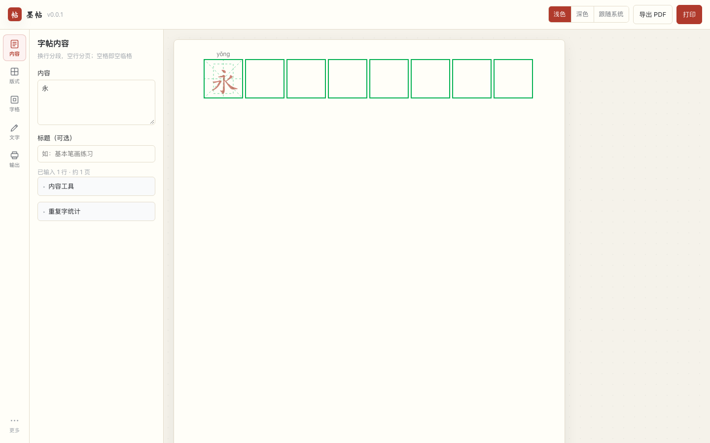
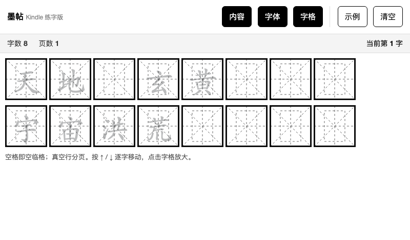

<div align="center">

# 墨帖 · motie

**纯前端字帖工具** —— 输入汉字，实时生成可打印、可导出 PDF 的字帖；同一套核心，另配一个为 Kindle 黑白墨水屏精简的**练字版**。（另有 Go 内核 + 原生窗口壳的**桌面版**，见[桌面版架构设计](doc/desktop-architecture.md)）

`纯前端单文件` · `桌面版（本机服务 + 原生窗口）` · `核心离线可用` · `v0.0.1`



*完整版：左侧内容与设置，右侧按真实纸张尺寸与页边距实时预览。*

</div>

## 目录

- [两个版本](#两个版本)
- [功能特性](#功能特性)
- [使用方法](#使用方法)
- [本地运行与构建](#本地运行与构建)
- [文档](#文档)
- [说明与安全](#说明与安全)

## 两个版本

|  | 完整版 `dist/index.html` | 练字版 `lite/index.html` |
| --- | --- | --- |
| 定位 | **做字帖**（生成 / 打印 / 导出 PDF），也可练字 | **练字**（离线，黑白墨水屏精简） |
| 适用环境 | 现代浏览器（Chrome / Edge / Firefox / Safari） | Kindle 实验浏览器及其他老式浏览器 |
| 技术形态 | React 18 + Redux + Vite，构建为单文件 | ES5 + 常规 CSS，单文件自包含 |
| 体积 | 约 420 KB（笔顺 / 拼音走 CDN；PDF 由桌面内核组装） | 约 43 KB，无外部依赖 |
| 偏好存储 | localStorage（键 `zitie.config`，两版共用） | 同键，仅内容 / 字格样式 / 字体地址 |

老设备会由入口脚本自动选择练字版，见[浏览器识别](doc/browser-detect.md)。

<div align="center">



*练字版：顶栏分组 + 状态栏 + 整页描红，空临格同样补满整行。*

</div>

### 功能对照

| 功能 | 完整版 | 练字版 |
| --- | --- | --- |
| 排版模板 | ✓ 正常 / 整页描红 / 一字三描红 / 首字范字 / 空临格 | ✗ 固定整页描红 |
| 字格 | 7 种样式 × 3 种颜色，56–120 px | 其中 4 种，固定灰色 80px |
| 文字颜色 / 深浅 | ✓ 朱砂 / 墨色 / 赭石，15%–100% | ✗ 固定墨色描红 |
| 版式微调 | ✓ 每行格数 / 行距 / 标题 | ✗ 固定版式，无标题 |
| 空格子 | ✓ 空格即空临格，行尾自动补满 | ✓ 同左 |
| 拼音标注 | ✓ pinyin-pro（联网按需加载） | ✗ |
| 笔顺动画 | ✓ HanziWriter（点击字格逐笔演示） | ✗ |
| 自定义字体 | ✓ 本地字体库 + 网络地址 | ✓ 地址 + 服务字体列表 |
| 导出 PDF | ✓ A4（桌面版由 Go 内核组装落盘） | ✗ |
| 字数上限 | 5000 | 5000 |

两个版本都能练字：练字版固定「整页描红」（汉字浅色、字格灰色），打印后照着练；完整版可在「版式」里切换模板达到同样效果。做字帖、需要笔顺演示或导出 PDF 时用完整版。

## 功能特性

- **排版模板**：正常（全深色范字）、整页描红、一字三描红（每行前 N 格深色范字 + 其余浅色）、首字范字、空临格；完整版用缩略图点选
- **字格**：田字格 / 米字格 / 米字格加回字框 / 回字格 / 拼音格 / 作文格 / 数字格，背景由代码生成 SVG data URI，零图片请求
- **文字样式**：颜色与深浅独立于字格颜色；正文默认系统楷体（Kaiti SC / 楷体）
- **版式**：每行格数（0 = 按纸张自适应，格子按可用宽均分铺满；锁定后整行居中）、行距、内容标题（居中，打印与 PDF 同步）
- **空格子**：内容里的空格即空临格，与有字格同一套字格（仅无字）；每行末尾自动补满到整行格数，**每页也铺满整页行数**（内容不足的行补空临格，打开就是完整字帖纸）。相邻字格共享边界线（屏幕 / 打印 / PDF 均为单线，不出现双线）。内容页提供「插入空格」「插入空白页」按钮；真空行 = 分页，只含空格的行 = 一整行空临格
- **拼音标注**：预览在拼音格上区四线三格内显示带声调拼音（仅「拼音格」；字帖不显示拼音、仅保留四线三格。完整版按需加载 pinyin-pro）
- **笔顺动画**：单击字格编辑单字，双击 / 空格放大单字并逐笔演示，加载失败自动降级为静态放大；支持 Esc / 点击遮罩关闭
- **真实预览**：预览纸宽与页边距按配置的毫米值以 96 dpi 换算，打印时交还 `@page`，所见即所得
- **设置持久化**：内容、模板、字格、文字自动保存到浏览器本地（兼容旧键 `zitie-lite.config`）
- **一键打印 / 导出 PDF**：自动隐藏操作面板与装饰，仅输出字帖内容
- **字帖库（桌面版）**：本机 txt / md 内容源建立索引（标题 / 字数 / 收藏 / 时间），打开、另存、重命名、删除、搜索一体；PDF 由 Go 内核组装落盘，不再依赖前端 jsPDF

## 使用方法

1. 构建后拷贝整个 `dist/` 目录（`index.html` 与 `lite/` 需同目录：老设备打开 `index.html` 会自动跳转练字版，只拷单文件时跳转会 404），把 `dist/index.html` 拖进浏览器打开即可（`file://` 也能正常工作）。
2. 或在项目目录执行 `npm run dev`，访问 <http://localhost:5173/> 预览。
3. 在左侧输入汉字内容、选模板、调字格与版式，右侧实时预览。
4. 点击「打印字帖」，或使用 `Ctrl / Cmd + P`；打印对话框选「另存为 PDF」亦可。桌面版可直接点击「导出 PDF」生成 A4 PDF（纯浏览器单文件形态不提供 PDF 合成，入口置灰）。
5. 桌面版：构建 Go 内核与平台壳后运行（见[桌面版架构设计](doc/desktop-architecture.md)）；开发联调可用 `make run`，或 `MOTIE_NO_WINDOW=1 make run` 只起服务不拉窗口。

## 本地运行与构建

```bash
npm install          # 安装构建依赖（Vite / React / esbuild 等）
npm run dev          # Vite 开发服务器（http://localhost:5173）
npm run build        # 生成 dist/（完整版单文件 + 练字版）；加 -- --vendor 构建离线部署包
npm run build:react  # 仅完整版多文件产物（dist-react/，http 部署）
npm run build:lite   # 仅重新生成 lite/index.html（练字版）
npm run vendor       # 下载 hanzi-writer / pinyin-pro 到 vendor/
```

桌面版发版流程使用 `make release`（发版向导：版本推导、VERSION 与 package.json 同步校验；git 动作默认 dry-run 只打印待执行命令，`make release ARGS=--commit` 才真实提交并打 Tag 推送）。

供 Kindle 等老设备经 HTTP 访问时，用 Go 内核作服务器（内嵌前端产物）：`make run`（或 `MOTIE_NO_WINDOW=1 make run` 只起服务不拉窗口）。标准版打开 `http://<本机IP>:<端口>/index.html`，练字版 `http://<本机IP>:<端口>/lite/index.html`；在字体管理器「发布」后，练字版刷新即可在网络字体列表看到。

`dist/` 与 `lite/` 均已 gitignore，由构建生成。分发时需整个 `dist/` 目录（`index.html` 与 `lite/` 同目录）：老设备打开 `index.html` 会自动跳转 `lite/index.html`；若只拷贝 `index.html`，练字版跳转会 404。只分发给 Kindle 时可单独拷 `lite/index.html`。

**示例字体（`font/`）不随仓库分发**（共约 39MB，已 gitignore）。新克隆构建出的 `dist/font/` 为空，「本地字体」模式没有内置示例；如需内置示例，请自行把 ttf / otf / woff 字体放入 `font/` 后重新 `npm run build`（构建时会给出显式警告）。用户自己的字体走字体管理器导入，不受此影响。

## 文档

- [技术说明](doc/architecture.md)：框架 / 构建、共享核心、模块清单、打印与目录结构
- [网页功能设计](doc/web-features.md)：功能地图、优先级与分期（**当前重点**）
- [桌面版架构设计](doc/desktop-architecture.md)：Go 内核 + 内嵌 React + 平台 WebView 壳（含落地状态）
- [练字版（Kindle）说明](doc/lite-kindle.md)：定位与交互、服务模式（字体发布 / 列表）
- [浏览器识别](doc/browser-detect.md)：能力探测、UA 特征与 URL 覆盖参数
- [常见问题](doc/faq.md)

## 说明与安全

- 浏览器单文件形态为纯静态、无后端、无遥测，偏好保存在本机浏览器；桌面版增加本机服务（默认仅监听回环地址），配置与字帖数据存放在本机应用数据目录，同样无遥测。
- 自定义字体地址仅接受 http(s) 或相对路径，避免 CSS 注入；本地字体走 IndexedDB 导入。
- 第三方库均来自公开 CDN（jsDelivr），也可用 `npm run vendor` 本地化；PDF 导出不再依赖前端 JS 合成库（逐页光栅化为 JPEG，由桌面内核直通嵌入组装）。
- **离线边界**：默认构建的**拼音 / 笔顺动画**按需从 CDN 加载，离线时自动降级（不显示拼音 / 静态放大）；**排版 / 打印完全离线可用**，桌面版**导出 PDF** 亦完全离线（纯浏览器单文件无内核，导出入口置灰，可用系统打印「另存为 PDF」替代）。需要完全离线时执行 `npm run vendor`，并用 local 模式（vendor 资源需 http 托管）。
- 仓库未附授权许可文件，仅限个人学习交流使用。
