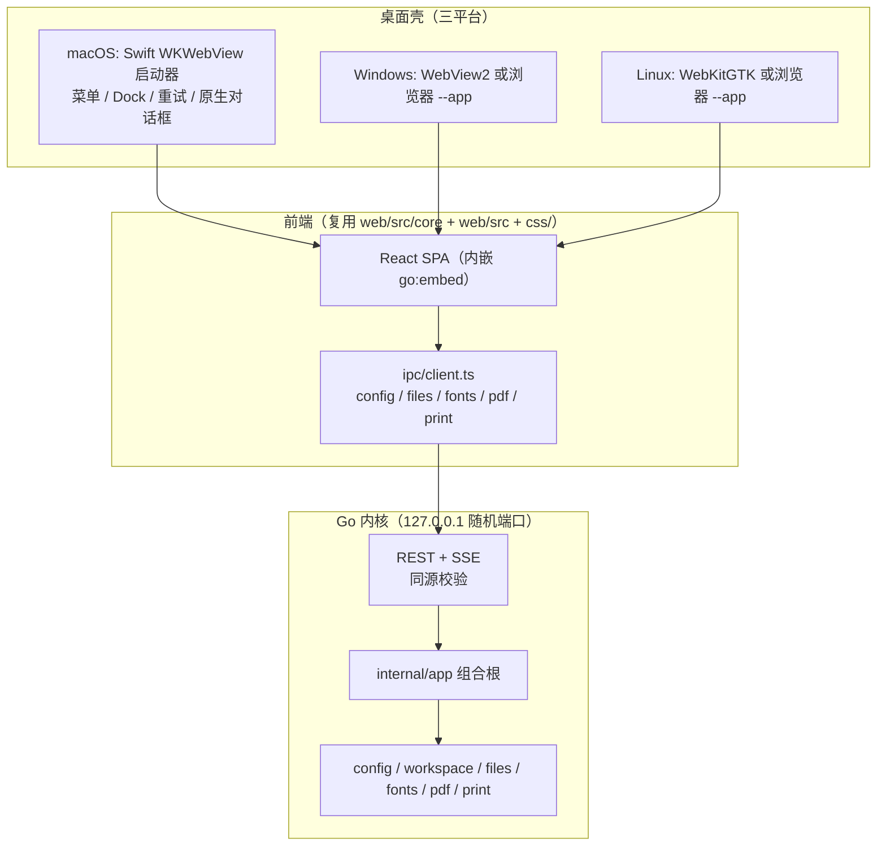

# 桌面版架构设计（Go 内核 + 内嵌 React + 平台 WebView 壳）

> 本文描述 **motie 桌面版** 的架构设计，作为以后实现 app 时的存档。当前重点是[网页功能设计](web-features.md)，桌面版暂不实现。
> 目标：把现有纯前端字帖工具做成 macOS / Windows / Linux 桌面应用；**Kindle 版（lite）与标准版仍然并存**。

## 1. 背景与目标

现状：标准版是浏览器单文件（React 18 + Redux + Vite，`dist/index.html`），lite 是 ES5 单文件（`lite/index.html`）。能力集中在浏览器 API 上：localStorage 存配置、IndexedDB 存字体、浏览器打印、jsPDF 前端生成。

桌面化的收益（也是做它的理由）：

- 直接读写 txt / md 字帖内容，多文件与最近打开
- 本地字体库：扫描系统字体 + 用户导入，不再受 IndexedDB 限制
- PDF 落盘到指定路径；原生打印面板
- 版式预设（模板 / 字格 / 页边距组合）持久化
- 脱离浏览器标签页，独立窗口与 Dock / 任务栏存在感

明确**不做**的事：不重写排版核心（`web/src/core/` 与 `css/` 是经过实测的真源）；不引入 Node 运行时；不把 Kindle 版并入桌面（它继续是零依赖单文件）；不引入 MCP。

## 2. 可复用资产盘点

| 资产 | 桌面版处置 |
| --- | --- |
| `web/src/core/content.js`（parse / paginate / 空临格语义） | **原样复用**（纯逻辑 ESM） |
| `web/src/core/sheet-layout.js`、`pdf.js`、`config.js`、`font-store.js`、`font.js` | 原样复用；IndexedDB 字体仓库在桌面端切到 Go 字体服务 |
| `web/src/core/pinyin.js`、`stroke.js`、`assets.js`（CDN / vendor 加载器） | 复用；桌面端可默认 `vendor` 本地化，彻底离线 |
| `css/main.css`、`web/src/*`（React 面板 / 预览 / 放大层） | 复用；把「存储 / 文件 / 打印 / 字体」调用切到 IPC 客户端 |
| `lite/`、`lite-src/` | **独立保留**，桌面端提供「导出 Kindle 版」入口 |
| `test/shared.test.js` | 共享核心测试继续跑；新增 Go 侧契约测试 |

## 3. 总体架构



分层：**壳（窗口）→ 接口层（REST/SSE）→ 组合根（装配）→ 领域服务 → 基础设施**。壳只负责窗口与原生能力，业务全在 Go 内核。

## 4. 目录结构

```
motie/
├── main.go                 # 入口：embed、构建信息注入
├── serve.go                # 启动编排：端口 / 单实例 / 装配 / HTTP 生命周期 / 收尾
├── desktop.go              # 跨平台窗口拉起、子进程跟踪、退出钩子
├── console_other.go / console_windows.go
├── internal/
│   ├── app/                # 组合根（New 装配全部依赖，Close 统一释放）
│   ├── api/                # REST/SSE Server、同源校验、模块路由
│   ├── application/        # 用例层（workspace / export 规划等）
│   ├── domain/             # 契约：事件常量、DTO（typegen 输入）
│   ├── config/             # SSOT 配置（JSON 落盘）
│   ├── workspace/          # 当前字帖：内容、光标、预设
│   ├── files/              # txt / md 读写、最近文件
│   ├── fonts/              # 系统字体扫描 + 用户字体库
│   ├── pdf/                # 接收前端 jsPDF blob 落盘
│   ├── print/              # 原生打印（平台实现）
│   └── infrastructure/     # fsutil / netutil / jsonutil / procgroup ...
├── native_macos/
│   └── main.swift          # macOS WKWebView 启动器
├── web/ css/ lite/ lite-src/   # 现有前端（核心在 web/src/core）与练字版副本
├── cmd/typegen/            # Go struct → TS 类型 + JSON 样本
└── docs/desktop-architecture.md
```

设计取舍：**不引入** Node 运行时（无外部预览进程守护）、无多格式构建管线（导出固定 PDF）、无 MCP。

## 5. Go 内核设计

### 5.1 入口与编排
- `main.go`：`//go:embed web/dist/*`、`VERSION`、`CHANGELOG.md`；构建信息 `-X main.Version=...` 注入，与版本常量同名同值，保证 REST 与界面口径一致。
- `serve.go`：
  - 端口优先级 **CLI > 配置 > 默认（39130）**，占用时向后顺延（`netutil.ListenAvailable`）。
  - **单实例保护**：探测端口区间 `/api/config` 的 `app == "motie"`，已有实例则为其打开新窗口后退出。
  - **监听地址默认 127.0.0.1**（安全底线）；非回环需在启动日志明确警告。
  - `http.Server.BaseContext` 用内核根 Context 派生，`Close()` 一次性取消在途请求（导出等）。
  - 退出来源统一：信号（SIGINT/SIGTERM/SIGHUP）与窗口退出钩子走同一收尾路径（避免孤儿进程）。
- `desktop.go`：`desktopUIProcess` 跟踪窗口子进程；窗口退出 → 通知主进程 → 统一 `Close()` + `httpServer.Shutdown(15s)`。

### 5.2 接口层（REST + SSE + 同源校验）
- `internal/api.Server` 回归**纯传输层**：模块注册、路由分发、静态托管、连接生命周期；领域逻辑在 `internal/app` 装配的 `ServerDeps`。
- 静态资源：`http.FileServer(http.FS(webFS))`；**未知 `/api/*` 必须 404**，不得降级为 `index.html`（防止契约漂移被伪装成正常页面）。
- **安全模型（不引入 Token）**：默认只绑 `127.0.0.1`（非回环需显式开启，并在启动日志明确警告）；**写操作校验 `Origin`**——仅放行 `http://127.0.0.1:<port>`（或缺失，对应原生窗口 / file:// 直开），拒绝跨域来源，防 DNS rebinding；文件写路径限制在用户选择的目录或应用数据目录内。Token 属过度设计（无命令执行 / 依赖安装，写操作面小），未来若支持局域网或多设备访问再引入。
- SSE：`/api/events` 事件总线；`WriteTimeout` 放大到 24h，慢请求上限由 handler 内 context 控制。

### 5.3 组合根
`internal/app.New(webFS)` 集中装配：事件总线、config 变更回调、workspace / files / fonts / pdf / print 服务、`api.NewServerWithDeps(...)`。新增实现只改组合根；`Close()` 幂等并注销进程级回调（避免重复装配残留）。

### 5.4 契约与 typegen
- 领域 DTO / 枚举集中在 `internal/domain`，`cmd/typegen` 用 `go/ast` 解析 Go struct，生成 `web/src/generated/types.ts` 与 JSON 样本；`-check` 用于只读校验漂移。
- SSE 事件名集中常量（kebab-case），前后端镜像同步（新增事件改三处：Go 常量、前端 events、前端订阅列表）。

### 5.5 配置 SSOT
`internal/config`：单一 `Config` struct + JSON 落盘（`os.UserConfigDir()/motie/config.json`）；`ConfigPath()` / `AppConfigDir()` 并发安全；默认端口 / 绑定地址跨端一致性由测试校验。

## 6. 平台壳

### 6.1 macOS（原生 WKWebView 启动器）
- WKWebView 承载 `http://127.0.0.1:<port>`；独立菜单栏（关于 / 隐藏 / 退出，Cmd+Q）、Dock 点击重开、关窗隐藏而非退出。
- **加载失败自动重试**（后端先起服务，首帧可能 connection refused）：最多 60 次、800ms 间隔。
- 原生 `alert / confirm / prompt` 桥接（否则前端确认框在 WKWebView 内失效）。
- 外链（非 127.0.0.1）交系统浏览器；`window.open` 拦截。
- JS→原生桥（`messageHandlers`）预留：全屏、原生打印、字体选择。
- 打包：`.app` + DMG，签名 + 公证。

### 6.2 Windows / Linux（回退策略）
- 优先系统 WebView2（Win）/ WebKitGTK（Linux）原生绑定；未命中时回退浏览器 `--app=<url>` 独立窗口（Edge / Chrome / Chromium），并跟踪子进程生命周期。
- 打包：Win NSIS / 便携 zip；Linux AppImage / deb / rpm（GoReleaser）。

## 7. 领域服务（motie 特有）

| 模块 | 职责 | 关键接口（示意） |
| --- | --- | --- |
| `config` | 用户偏好 SSOT：主题、模板、字格、页边距、字体地址、资源模式（cdn/local） | `Get` / `Set` / `OnChange(bus)` |
| `workspace` | 当前字帖：内容、当前字、最近文件、版式预设（preset 列表） | `Open` / `Save` / `ListRecent` / `Presets` |
| `files` | txt / md 读写；导入导出；路径安全校验（防目录穿越） | `Read` / `Write` / `Export` |
| `fonts` | 系统字体扫描（平台实现）+ 用户字体库（SQLite 索引 + 文件落盘） | `ListSystem` / `AddUser` / `Remove` |
| `pdf` | 接收前端 jsPDF 生成的 Blob，落盘到用户指定路径 | `SavePDF(filename, base64)` |
| `print` | 原生打印面板（mac `NSPrintOperation`；Win/Linux 对应实现） | `Print(html)` |
| `assets` | CDN / local 资源模式；vendor 本地化校验 | `Mode` / `LocalBaseURL` |

说明：**PDF 仍由前端 jsPDF 生成**（排版、中文字体嵌入已在浏览器侧验证），Go 只负责落盘，避免重复实现。

## 8. 前端改造（最小侵入）

- 新增 `web/src/ipc/client.ts`：transport + 领域客户端（config / files / fonts / pdf / print）。
- 把现有浏览器 API 调用替换为 IPC（保持 UI 与状态层不变）：
  - `localStorage` → `config` 服务
  - IndexedDB 字体 → `fonts` 服务
  - 「导入 txt / 导出 txt」→ `files` 服务
  - 「导出 PDF」→ 前端 jsPDF 生成 → `pdf.SavePDF`
  - 「打印」→ `print.Print`（或保留浏览器打印作为回退）
- 桌面端隐藏「浏览器检测 / 跳转到 lite」逻辑，改为「导出 Kindle 版」按钮。
- 窗口尺寸 / 缩放 / 全屏走原生桥。

## 9. Kindle 版定位（不变）

- `lite/index.html` 继续是**零依赖单文件**（约 35 KB，file:// 直开），服务模式（字体列表）保持不变。
- 「独立」指分发 / 运行形态：可拷到 Kindle / 断网 / 别人电脑直接打开；**同时允许**桌面 Go server 托管 `/lite/`，复用字体服务，但不依赖它。
- 桌面端一键「导出 Kindle 版」= 复制 `lite/index.html`（或经 Go 重新构建）到目标目录。
- lite 的 UX 与标准版共享 `lite-src/vendor/`（与 `web/src/core` 同源的独立副本）与 `css` 字格逻辑，继续同步修复。

## 10. 分阶段路线（建议 TODO 驱动）

0. **抽象与契约**：定义 `config / files / fonts / pdf / print` 接口与 DTO；前端抽出 `ipc/client.ts`（可先做浏览器 mock 后端，UI 不落地）。
1. **Go 内核 + mac 壳（MVP）**：本地 HTTP + 同源校验 + 静态托管 + config 落盘 + txt 读写 + 原生打印；能打开窗口、编辑、导出 PDF。
2. **桌面能力补齐**：系统字体扫描 + 用户字体库（SQLite）；版式预设；最近文件。
3. **Windows / Linux 壳**：WebView2 / WebKitGTK，复用同一 Go 后端与前端。
4. **打磨**：完全离线（vendor 内联）、Go server 托管 `/lite/`、Dock / 托盘、自动更新（可选）。

每阶段验收：`go test ./...` + 前端 `npm test` + typegen `-check` + 三平台（或至少 mac）真机冒烟。

## 11. 风险与未决问题

- **三平台 WebView 差异**：打印分页、字体加载、`confirm/alert` 行为需各平台实测（mac 已有桥接方案）。
- **本地服务端口**：固定端口易冲突，建议随机端口 + 单实例探测；同源校验需覆盖所有写接口（新增写接口必须同步放行规则，防止漏校验）。
- **PDF 中文体积**：jsPDF 内嵌字体，落盘路径与文件名需处理非法字符。
- **字体授权**：扫描系统字体仅展示名称，不复制文件；用户导入字体需提示授权。
- **MCP**：不引入；若将来需要 AI 联动，优先 CLI / URL scheme。

## 12. 实现要点清单

| 模块 | 要点 |
| --- | --- |
| `main.go` | embed + 构建信息注入 |
| `serve.go` | 端口顺延 / 单实例 / 根 Context / 退出收尾 |
| `desktop.go` | 窗口拉起 + 子进程跟踪 + 退出钩子（回退浏览器 --app） |
| `native_macos/main.swift` | WKWebView：菜单 / Dock / 重试 / alert 桥接 / 外链 |
| `internal/app` | 组合根 + 幂等 `Close` |
| `internal/api.Server` | 同源校验 + 静态 404 规则 + SSE |
| `internal/domain` + `cmd/typegen` | 事件常量 + Go→TS 契约 |
| `internal/config` | SSOT JSON |
| `internal/fonts` / `print` / `infrastructure/*` | 平台能力与工具，按 motie 简化 |
