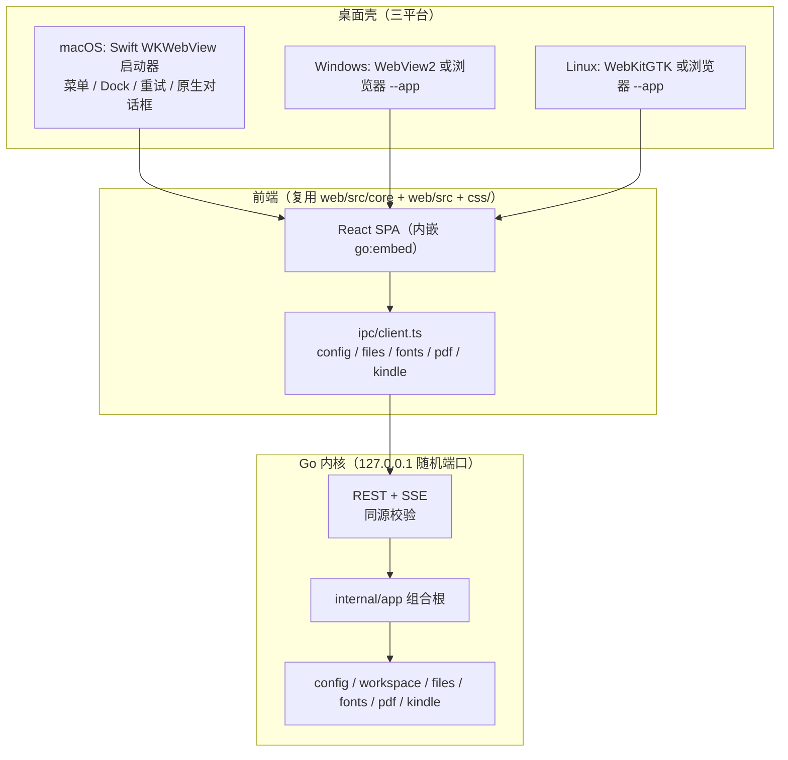

# 桌面版架构设计（Go 内核 + 内嵌 React + 平台 WebView 壳）

> 本文描述 **motie 桌面版** 的架构设计与落地状态。桌面版已实现（Go 内核 + REST/SSE + 内嵌 React；macOS 原生 Swift WKWebView 壳，Windows / Linux 回退浏览器 `--app`），Kindle 版（lite）与标准版并存。
> 文中「已实现」均指当前代码现状；未落地项会明确标注。

## 1. 背景与目标

现状：标准版是浏览器单文件（React 18 + Redux + Vite，`dist/index.html`），lite 是 ES5 单文件（`lite/index.html`）。能力集中在浏览器 API 上：localStorage 存配置、IndexedDB 存字体、浏览器打印；PDF 早期由 jsPDF 前端生成，现已改为 Go 侧组装。

桌面化的收益（也是做它的理由）：

- 直接读写 txt / md 字帖内容，多文件与最近打开
- 本地字体库：扫描系统字体 + 用户导入，不再受 IndexedDB 限制
- PDF 落盘到指定路径；原生打印面板
- 版式预设（模板 / 字格 / 页边距组合）持久化
- 脱离浏览器标签页，独立窗口与 Dock / 任务栏存在感

明确**不做**的事：不重写排版核心（`web/src/core/` 与 `css/` 是经过实测的真源）；不引入 Node 运行时；不把 Kindle 版并入桌面（它继续是零依赖单文件）；不引入 MCP。

## 2. 可复用资产盘点

| 资产 | 桌面版处置 |
| --- | --- |
| `web/src/core/content.js`（parse / paginate / 空临格语义） | **原样复用**（纯逻辑 ESM） |
| `web/src/core/sheet-layout.js`、`pdf.js`、`config.js`、`font-store.js`、`font.js` | 原样复用；IndexedDB 字体仓库在桌面端切到 Go 字体服务 |
| `web/src/core/pinyin.js`、`stroke-order.js`、`assets.js`（CDN / vendor 加载器） | 复用；桌面端可默认 `vendor` 本地化，彻底离线 |
| `css/main.css`、`web/src/*`（React 面板 / 预览 / 放大层） | 复用；把「存储 / 文件 / 打印 / 字体」调用切到 IPC 客户端 |
| `lite/`、`lite-src/` | **独立保留**，桌面端提供「导出 Kindle 版」入口 |
| `test/shared.test.js` | 共享核心测试继续跑；新增 Go 侧契约测试 |

## 3. 总体架构



分层：**壳（窗口）→ 接口层（REST/SSE）→ 组合根（装配）→ 领域服务 → 基础设施**。壳只负责窗口与原生能力，业务全在 Go 内核。

## 4. 目录结构

```
motie/
├── main.go                 # 入口：//go:embed all:dist 与 all:lite（双份产物）、构建信息注入
├── serve.go                # 启动编排：端口 / 单实例 / 装配 / HTTP 生命周期 / 收尾
├── desktop.go              # 跨平台窗口拉起、子进程跟踪、退出钩子
├── console_other.go / console_windows.go
├── internal/
│   ├── app/                # 组合根（New 装配全部依赖，Close 统一释放）
│   ├── api/                # REST/SSE Server、同源校验、模块路由（纯传输层）
│   ├── domain/             # 契约：事件常量、DTO（typegen 输入）
│   ├── config/             # SSOT 配置（JSON 原子落盘）
│   ├── workspace/          # 版式预设（JSON 落盘）
│   ├── files/              # txt / md 受控子树读写、最近文件
│   ├── fonts/              # 系统字体扫描 + 用户字体库（零依赖 JSON 索引）
│   ├── pdf/                # 接收前端光栅化的每页 JPEG，组装为 PDF 落盘
│   ├── kindle/             # 导出内置 lite 单文件到 export/
│   ├── version/            # 版本号常量
│   └── infrastructure/     # 预留（当前为空目录）
├── native_macos/
│   └── main.swift          # macOS WKWebView 启动器
├── web/ css/ lite/ lite-src/   # 现有前端（核心在 web/src/core）与练字版副本
├── cmd/typegen/            # Go struct → TS 类型 + JSON 样本
└── doc/desktop-architecture.md
```

设计取舍：**不引入** Node 运行时（无外部预览进程守护）、无多格式构建管线（导出固定 PDF）、无 MCP。

## 5. Go 内核设计

### 5.1 入口与编排
- `main.go`：`//go:embed all:dist` + `//go:embed all:lite`（完整版与 lite 各持一份产物）、`VERSION`；构建信息 `-X main.Version=...` 注入，与 `internal/version` 常量同名同值，保证 REST 与界面口径一致。
- `serve.go`：
  - 端口优先级 **CLI > 配置 > 默认（39130）**，占用时向后顺延（`ListenAvailable`，最多 10 个）。
  - **单实例保护**：在顺延区间（preferred..+9）探测 `/api/config` 的 `app == "motie"`（`FindRunning`），命中则返回携带**实际端口**的 `AlreadyRunningError`；调用方据此为既有实例打开窗口后退出——首实例被挤到邻端口时不会另起服务。
  - **监听地址默认 127.0.0.1**（安全底线）；非回环需在启动日志明确警告。窗口地址与实例探测统一经 `clientHost` 映射：通配监听（`0.0.0.0` / `::`）与 `localhost` 落到具体回环地址（避免 0.0.0.0 作为目的地址在部分平台不可达），纯 IPv6 回环保持 IPv6 族（`[::1]`，不误转 IPv4）。
  - `http.Server.BaseContext` 用内核根 Context 派生，`Close()` 一次性取消在途请求（导出等）。
  - 退出来源统一：信号（SIGINT/SIGTERM/SIGHUP）与窗口退出钩子走同一收尾路径（避免孤儿进程）。
- `desktop.go`：`desktopUIProcess` 跟踪窗口子进程；窗口退出 → 通知主进程 → 统一 `Close()` + `httpServer.Shutdown(15s)`。

### 5.2 接口层（REST + SSE + 同源校验）
- `internal/api.Server` 回归**纯传输层**：模块注册、路由分发、静态托管、连接生命周期；领域逻辑由 `internal/app` 装配并以 `api.Deps` 注入。
- 静态资源：服务端自读 `WebFS`（`serveStatic` 按路径取文件，缺失回退 `index.html`；不用 `http.FileServer`，避开其对 `/index.html` 的 301 重定向）；lite 子树 `/lite/` 缺失即 404、不回退完整版；**未知 `/api/*` 必须 404 JSON**，不得降级为 `index.html`（防止契约漂移被伪装成正常页面）。
- **安全模型（不引入 Token）**：默认只绑 `127.0.0.1`（非回环需显式开启，并在启动日志明确警告）；**写操作校验 `Origin`**——仅放行 `http://127.0.0.1:<port>`（或缺失，对应原生窗口 / file:// 直开），拒绝跨域来源，防 DNS rebinding；文件写路径限制在用户选择的目录或应用数据目录内。Token 属过度设计（无命令执行 / 依赖安装，写操作面小），未来若支持局域网或多设备访问再引入。
- SSE：`/api/events` 事件总线；`WriteTimeout` 放大到 24h，慢请求上限由 handler 内 context 控制。

### 5.3 组合根
`internal/app.New(webFS)` 集中装配：事件总线、config 变更回调、workspace / files / fonts / pdf / kindle 服务，以及 `api.New(Deps{...})`。新增实现只改组合根；`Close()` 幂等并注销进程级回调（避免重复装配残留）。

### 5.4 契约与 typegen
- 领域 DTO / 枚举集中在 `internal/domain`，`cmd/typegen` 用 `go/ast` 解析 Go struct，生成 `web/src/generated/types.ts` 与 JSON 样本；`-check` 用于只读校验漂移。
- SSE 事件名集中常量（kebab-case），前后端镜像同步（新增事件改三处：Go 常量、前端 events、前端订阅列表）。

### 5.5 配置 SSOT
`internal/config`：单一 `Config` struct + JSON 落盘（`os.UserConfigDir()/motie/config.json`）；`ConfigPath()` / `AppConfigDir()` 并发安全；默认端口 / 绑定地址跨端一致性由测试校验。

## 6. 平台壳

### 6.1 macOS（原生 WKWebView 启动器）
- WKWebView 承载 `http://127.0.0.1:<port>`；独立菜单栏（关于 / 隐藏 / 退出，Cmd+Q）、Dock 点击重开、关窗隐藏而非退出。
- **加载失败自动重试**（后端先起服务，首帧可能 connection refused）：最多 60 次、800ms 间隔。
- 原生 `alert / confirm / prompt` 桥接（否则前端确认框在 WKWebView 内失效）。
- 外链（非 127.0.0.1）交系统浏览器；`window.open` 拦截。
- JS→原生桥（`messageHandlers`）预留：全屏、原生打印、字体选择。
- 打包：`.app` + zip / DMG（`make app-macos`；签名 + 公证）。

### 6.2 Windows / Linux（回退策略）
- 内核按同目录壳查找：`motie-shell.exe`（WebView2 宿主，源码 `native_windows/motie-shell.cs`）/ `motie-shell`（WebKitGTK 宿主，源码 `native_linux/motie-shell.c`）；未随包分发时回退浏览器 `--app=<url>` 独立窗口（Edge / Chrome / Chromium），并跟踪子进程生命周期。
- 两平台壳**源码已备、未经本机验证**（macOS 无法编译运行）；2026-11-27 已对照 gi-docgen stable / Microsoft Learn 复核并修正信号回调签名、UA 设置与 IPv6 回环判定，挂载契约、构建方式、复核记录与目标机验收清单见 `doc/native-shells.md`。
- 关窗语义差异：mac 关窗隐藏常驻；Win/Linux 关窗退出壳进程（内核服务独立，不受影响）。
- 打包：Win 便携 zip（GoReleaser，GUI 子系统）；Linux tar.gz / deb / rpm（GoReleaser，含 `.desktop` + hicolor 图标）。

## 7. 领域服务（motie 特有）

| 模块 | 职责 | 关键接口（示意） |
| --- | --- | --- |
| `config` | 用户偏好 SSOT：主题、模板、字格、页边距、字体地址、资源模式（cdn/local） | `Get` / `Set` / `OnChange(bus)` |
| `workspace` | 版式预设持久化（JSON 落盘） | `List` / `Save` / `Delete` / `Rename` |
| `files` | txt / md 受控子树读写（相对路径口径）；最近文件 | `Read` / `Write` / `ListRecent` |
| `fonts` | 系统字体扫描（平台实现）+ 用户字体库（JSON 索引 + 文件落盘；原设计 SQLite，实现以零依赖 JSON 原子写替代） | `ListSystem` / `AddUser` / `Remove` |
| `pdf` | 接收前端光栅化的每页 JPEG（multipart 上传），自写组装为 PDF（`/DCTDecode` 直通）并原子落盘 | `Export(filename string, pages [][]byte, pageW, pageH float64)` |
| `print` | app 端由 mac 壳 Swift 桥调 WKWebView `printOperation(with:)` 原生面板（main.swift，打印 CSS 已生效）；web / 本地模式仍为浏览器 `window.print()`（usePrint）；Go 侧无 print 包 | — |
| `assets` | CDN / local 资源模式；vendor 本地化校验 | `Mode` / `LocalBaseURL` |

说明：**PDF 由 Go 组装**。前端只把每页绘制到 canvas 并导出 JPEG（0.92，1.5×），经 multipart 上传；Go 直接以 `/DCTDecode` 嵌入，不再走纯 JS 的 PNG 解码 / 重编码路径。纯浏览器环境（无桌面内核）不提供合成，导出入口置灰并提示。

## 8. 前端改造（最小侵入）

- 新增 `web/src/ipc/client.ts`：transport（HTTP / Mock）+ 领域客户端（config / files / fonts / pdf / kindle），UI 各处统一走 `sharedClient()` 共享实例。
- 把现有浏览器 API 调用替换为 IPC（保持 UI 与状态层不变）：
  - `localStorage` → 本地缓存 + `config` 服务镜像（本地优先写入，防抖 PUT 给内核；SSE `config.changed` 回填；见 §5.5）
  - IndexedDB 字体 → `fonts` 服务
  - 「导入 txt / 导出 txt」→ `files` 服务
  - 「导出 PDF」→ 前端逐页光栅化为 JPEG（`core/pdf.js` 的 `renderPages`）→ `POST /api/pdf/build`（multipart：`filename` / `width_mm` / `height_mm` / `count` + 同名 `page` 文件按页序）→ Go `ComposePDF` 组装并原子落盘 → SSE `pdf.saved` 通知
  - 「打印」→ app 端走 mac 壳 Swift 原生打印桥（WKWebView `printOperation`）；web / 本地模式仍由前端 `usePrint` 浏览器打印
- 桌面端隐藏「浏览器检测 / 跳转到 lite」逻辑，改为「导出 Kindle 版」按钮。
- 窗口尺寸 / 缩放 / 全屏走原生桥。

## 9. 三端接入与能力矩阵

目标：**app / web / lite 三端共用同一套 Go 内核与 REST 契约**。管理类能力（配置、字体库、字帖索引、版式预设、PDF、导出）不再有第二套实现，前端只做 transport 选择。

### 9.1 transport 自动探测（web 默认走 Go）

`ipc/client.ts` 的 `detectBackend()` 按以下顺序解析内核地址，命中即 `HTTPTransport`，全部落空才回落 `MockTransport`（本地模式）：

1. 壳注入 `window.__MOTIE_DESKTOP__` 与 `__MOTIE_BASE_URL__`（macOS / Windows / Linux 窗口）；
2. `location.origin`（http/https 直开产物）；
3. URL 参数 `?port=`；
4. `localStorage` 记忆的端口 `zitie.backend.port`；
5. 默认端口 `39130`。

每个候选以 `GET /api/config` + `data.app == "motie"` 探针确认（默认 700ms 超时）；候选挂起时由 `AbortController` 在上限内中止并继续尝试下一个候选，不会拖住启动。命中后写回端口记忆。

设置页「更多 → 接入」可**手动固定本机内核端口**（写入同一个 `zitie.backend.port`）并即时「测试连接」；固定端口在启动探测中优先于默认端口（URL `?port=` 仍最优先），保存后刷新页面生效。这样非默认端口部署不必每次带 `?port=`，也不会因首次探测失败而落入本地模式。旧逻辑靠 `serveStatic` 注入标志硬切 mock/http，已移除——web 与 app 走同一启动路径，差别只在探测结果。

### 9.1.1 能力门统一读接入模式

探测结果写入 Redux `ui.backend`（http / mock / init）后，所有「能力有无」的判定都以它为唯一真源：配置回推、字体库（Go fonts vs 浏览器 IndexedDB）、字帖/预设持久化、PDF 合成、导出 Kindle 版、检查更新。这样 web 经反代打开并探测到内核时，获得与 app 一致的能力；本地模式则自动回退浏览器侧实现（字体仍持久于 IndexedDB）。

唯一例外是**打印桥**：`isDesktopEnv()`（原生窗口）保留用于 WKWebView 的 Swift 打印调用——web 即便在线也只是浏览器 `window.print()`，不走原生面板。

本地模式另设**整包数据备份**入口（「更多」页数据备份组，仅 `ui.backend === 'mock'` 显示）：`core/backup.ts` 把统一快照打成带校验头（app / kind / version）的 JSON 导出，导入为合并语义（预设同名跳过、文件与字帖按 path 去重、字帖 id 冲突重分配、保留本机草稿 Content / Title），写回 `zitie.mock.v1` 后刷新生效。桌面端数据在 Go 侧磁盘，不经此入口。

### 9.2 本地模式的界面语义

未检测到内核时进入本地模式：配置 / 文件 / 字帖库 / 预设存 localStorage（统一快照 `zitie.mock.v1`），字体仍走 IndexedDB——**刷新与重开都在**，仅换设备 / 换浏览器 / 清站点数据会丢失，且不会进入 Go 内核的应用数据目录。顶栏在 `ui.backend === 'mock'` 时显示「本地模式」徽标（`title` 说明数据不跨设备）；Service Worker **仅在 mock（未接内核）且页面为 http(s) 协议时注册**——这是纯静态部署（无反代 / 无 Go server）时「打开过一次即可离线用」的手段；接了内核（http 模式）或桌面壳（file:// / 原生注入基址）都不注册，避免 SW 拦截 Go API 流量、也避免把内核数据缓存成「离线可用」的假象。

### 9.3 契约防漂移

同一份契约两端实现，必须有对照测试兜底：

| 测试 | 覆盖 |
| --- | --- |
| `cmd/typegen -check` | `internal/domain` → `types.ts` / `samples.json` 无漂移 |
| `test/api-contract.test.mjs` | Go 路由表 ↔ MockTransport 分支**双向**对照（新增 / 改名路由必须同步，SSE 与二进制直取显式豁免） |
| `test/transport-dto.test.jsx` | mock 返回的 DTO 字段覆盖 `samples.json`（Config / FontEntry / DocumentEntry / WorkspaceFile），并校验 config 恰为 `PREFS_KEYS` 白名单 |
| `test/mock-persist.test.jsx` | 本地模式状态（配置 / 文件 / 字帖库 / 预设）跨实例存活 + 旧键迁移 |
| `test/detect-backend.test.jsx` | 探测候选顺序、`app == "motie"` 判定、端口记忆与去重、超时上限中止与后续候选继续、手动端口读写/探针（18 例） |
| `test/detect-backend.e2e.test.mjs` | 真起 HTTP 服务 + headless Chrome：内核可达 → 无「本地模式」徽标；不可达 → 显示徽标（服务端以冒充 `/api/config` 验证探测逻辑） |
| `test/real-backend.e2e.test.mjs` | `go build` 真实内核 + `MOTIE_NO_WINDOW=1 -port=N` 只起服务 + CDP：`/api/config` 返回 `app=motie`、产物同源加载进入 http 模式（无「本地模式」徽标）、字体面板渲染真实系统字体（`/api/fonts` → UI）；无 Go / 无 Chrome 时跳过并声明 |
| `test/lite-serve.e2e.test.mjs` | 真托管 `dist/lite/index.html` + headless Chrome：有字体服务渲染 `.font-item`（`data-url=/api/fonts/file/<id>`）；`/api/fonts` 404 或空清单 → 面板隐藏不渲染 |
| `test/sw.e2e.test.mjs` | 真托管整个 `dist/` + headless Chrome（CDP）：mock+http(s) → 页面自动注册 `sw.js`、安装成功、激活并稳定存活；http 模式（在线内核）与 `file://` 直开 → 均不注册 |
| `test/a11y.e2e.test.mjs` | 真托管 `dist/` + CDP 注入 axe-core：WCAG 2.1 A/AA 标签扫描明/暗 × 全部面板页 + 预设导入 / 分享二维码 / 单字放大三浮层，critical/serious 与违规总数均要求为 0 |

已知修正：`domain.Config.FontURL` 的 JSON tag 由 `FontURL` 改为 `fontURL`，与 `web/src/core/config.js` 的 ConfigSchema / PREFS_KEYS / localStorage 键名统一（此前 HTTP 模式 GET 回填会丢字体地址）。

### 9.4 能力矩阵

| 能力 | app（内嵌窗口） | web（探测到内核） | web（本地模式） | lite |
| --- | --- | --- | --- | --- |
| 配置持久化 | ✅ Go config SSOT | ✅ 同左 | ⚠️ localStorage | ❌（自身偏好内存 / 表单） |
| 系统 + 用户字体库 | ✅ Go fonts | ✅ Go fonts | ⚠️ 浏览器 IndexedDB（随浏览器数据） | ✅ 服务模式（字体列表） |
| 字帖读写 / 索引库 | ✅ files + library | ✅ 同左 | ⚠️ localStorage 快照（刷新保留） | ❌ |
| 版式预设 | ✅ workspace | ✅ | ⚠️ localStorage 快照 | ❌ |
| PDF 合成导出 | ✅ Go 组装落盘 | ✅ | ❌ 入口置灰 | ❌ |
| 导出 Kindle 版 | ✅ | ✅ | —（入口隐藏，需内核落盘） | — |
| 打印 | ✅ 原生面板（Swift NSPrintOperation） | ✅ 浏览器打印 | ✅ 浏览器打印 | ✅ |
| 检查更新 | ✅ | ✅ | —（入口隐藏，依赖 Go update 服务） | ❌ |
| 多窗口 / 多端同步 | ✅ SSE | ✅ SSE | ❌ | ❌ |
| PWA 离线（Service Worker） | —（原生即离线，不注册） | —（不注册，API 不过 SW） | ✅ http(s) 直开时注册，导航 network-first、静态/CDN cache-first | ❌（file:// 不支持 SW） |

注：lite 继续是零依赖单文件，不并入桌面；桌面 Go server 可托管 `/lite/` 使其复用字体服务（见 §10），但 lite 不依赖该服务运行。

## 10. Kindle 版定位（不变）

- `lite/index.html` 继续是**零依赖单文件**（约 43 KB，file:// 直开），服务模式（字体列表）保持不变。
- 「独立」指分发 / 运行形态：可拷到 Kindle / 断网 / 别人电脑直接打开；**同时允许**桌面 Go server 托管 `/lite/`，复用字体服务，但不依赖它。
- 桌面端一键「导出 Kindle 版」= 复制 `lite/index.html`（或经 Go 重新构建）到目标目录。
- 服务模式的字体面板行为（成功渲染 / 404 隐藏 / 空清单隐藏）由 `test/lite-serve.e2e.test.mjs` 端到端锁定，与 Go `GET /lite/` 托管路径对应。
- lite 的 UX 与标准版共享 `lite-src/vendor/`（与 `web/src/core` 同源的独立副本）与 `css` 字格逻辑，继续同步修复。

## 11. 分阶段路线（建议 TODO 驱动）

0. ✅ **抽象与契约**（已完成）：`config / files / fonts / pdf / kindle` 接口与 DTO；`ipc/client.ts` + MockTransport。
1. ✅ **Go 内核 + mac 壳 MVP**（已完成）：本地 HTTP + 同源校验 + 静态托管 + config 落盘 + txt 读写 + PDF 组装导出；Swift WKWebView 壳可用（含托盘 / Dock 重开与原生打印桥），未装 swiftc 时回退 Chromium `--app`。
2. ✅ **桌面能力补齐**（已完成）：系统字体扫描 + 用户字体库（JSON 索引）；版式预设；最近文件。
3. 🚧 **Windows / Linux 原生壳**：两平台当前一律走 Chromium 系 `--app` 回退（desktop_windows.go / desktop_linux.go），Go 侧挂载点为同目录 `motie-shell.exe` / `motie-shell`；两平台壳源码已备（`native_windows/motie-shell.cs`、`native_linux/motie-shell.c`），但无法在本机（macOS）编译 / 运行验证，首次目标机构建与行为核对见 `doc/native-shells.md`。已实测的有限子集：`GOOS=windows/linux`（amd64、arm64）交叉编译通过、带 PE 资源链接通过；发布资产链本机可生成（gen-assets → Linux hicolor 9 尺寸图标 / Windows syso）；`goreleaser release --snapshot` 本机实跑成功——Windows zip / Linux tar.gz 内容正确，deb/rpm 含 `/usr/bin/motie` + `motie.desktop`（`Exec=motie %U`、`Icon=motie`）+ 9 尺寸图标，且 `motie.exe` 为 PE32+ GUI 子系统（subsystem=2，无控制台黑框）。
4. 🚧 **打磨**：完全离线（vendor 内联已支持 `--vendor` 构建）、Go server 托管 `/lite/`（已实现）、Dock / 托盘（mac 壳已实现：状态栏图标 + 菜单 / Dock 点击重开 / 关窗隐藏；Win/Linux 随原生壳一并待目标机）、自动更新（检查已实现并只提示下载地址；2026-11-27 已完成「是否引入签名校验后下载」评估，结论：维持只提示，依据见 §12）。
5. ✅ **三端接入统一**（已完成）：transport 自动探测（web 默认走 Go，见 §9.1）+ 本地模式标注 + 契约双向对照测试（`api-contract.test.mjs` / `transport-dto.test.jsx`）。
6. ✅ **能力门收口**（已完成）：字体库 / 字帖 / 预设 / PDF / 导出 / 更新全部改读 `ui.backend`（见 §9.1.1），仅打印桥保留壳判定；补充 `detect-backend` 单测与 e2e。
7. ✅ **本地模式持久化**（已完成）：mock 的配置 / 文件 / 字帖库 / 预设写入统一快照 `zitie.mock.v1`（字体仍在 IndexedDB），刷新不丢、旧 `zitie.config` 键自动迁移；`test/mock-persist.test.jsx` 锁定。

每阶段验收：`go test ./...` + 前端 `npm test` + typegen `-check` + 三平台（或至少 mac）真机冒烟。mac 真机冒烟已自动化兜底：`make check-contract` / `make test-backend`（-race）/ `make swift-ui`（原生壳编译）+ `npm test` 链内的 `test/real-backend.e2e.test.mjs`（真实 Go 内核端到端，见 §9.3）；Win / Linux 原生壳仍待目标机人工验收。

## 12. 风险与未决问题

- **三平台 WebView 差异**：打印分页、字体加载、`confirm/alert` 行为需各平台实测（mac 已有桥接方案）。
- **本地服务端口**：✅ 已实现占用顺延 + 单实例探测（`/api/config` 的 `app == "motie"`），扫描覆盖顺延区间且「已在运行」携带实际端口（`serve_test.go` 锁定首选 / 顺延 / 非 motie 三态）；`MOTIE_NO_WINDOW` 对既有实例分支同样生效（不为已运行实例拉窗口），真实双进程行为由 `test/single-instance.e2e.test.mjs` 锁定。
- **写接口同源守卫**：✅ 中间件集中校验 + `internal/api/origin_guard_test.go` 从源码解析全部路由，逐条断言「跨域 403 / 本机 Origin 放行」，新增写路由漏挂中间件会立即失败（含未知 `/api/*` 必须 JSON 404）。
- **PDF 中文体积**：页面为位图（JPEG 0.92、1.5× 分辨率），不含字体子集化；文件名已由 `internal/pdf.SafeFilename` 处理（非法字符替换 `_`、拒绝 `.` / `..` / 空名、缺扩展名补 `.pdf`、basename 化防穿越，含单测与路径穿越用例）。
- **字体授权**：扫描系统字体仅展示名称，不复制文件；用户导入字体需提示授权。
- **MCP**：不引入；若将来需要 AI 联动，优先 CLI / URL scheme。
- **自动更新是否引入下载**：✅ **已评估（2026-11-27）——维持只检查 + 提示下载地址**。依据：macOS 自动更新事实标准 Sparkle 官方文档要求 HTTPS appcast（ATS）、Developer ID 代码签名与公证、EdDSA(ed25519) 签名发布归档，且签名私钥必须离线保管（sparkle-project.org「Basic Setup」§3）；本项目分发形态为 GitHub Releases 便携包（Windows zip、Linux tar.gz / deb / rpm、macOS `make app-macos` 的 zip / dmg），无 appcast 与更新服务器，面向少量用户手动取包的成本可接受；Windows / Linux 亦无可信等价通道。若将来确需自动更新，最小路径 = macOS 接 Sparkle 2（EdDSA + Developer ID + 公证 + appcast），Win/Linux 仍只提示；不自研运行期下载 / 替换（避免替换正在运行的进程与无签名校验的中间人风险）。

## 13. 实现要点清单

| 模块 | 要点 |
| --- | --- |
| `main.go` | embed + 构建信息注入 |
| `serve.go` | 端口顺延 / 单实例 / 根 Context / 退出收尾 |
| `desktop.go` | 窗口拉起 + 子进程跟踪 + 退出钩子（回退浏览器 --app） |
| `native_macos/main.swift` | WKWebView：菜单 / Dock / 重试 / alert 桥接 / 外链 |
| `internal/app` | 组合根 + 幂等 `Close` |
| `internal/api.Server` | 同源校验 + 静态 404 规则 + SSE |
| `.goreleaser.yaml` + `scripts/` | Win/Linux 分发链：`goreleaser release --snapshot` 本机实测通过（zip/tar/deb/rpm、桌面入口与 9 尺寸图标、`motie.exe` PE32+ GUI 子系统） |
| `internal/domain` + `cmd/typegen` | 事件常量 + Go→TS 契约；json tag 与前端 ConfigSchema 键名一致 |
| `test/api-contract.test.mjs` / `test/transport-dto.test.jsx` | 路由双向对照 + mock DTO 字段覆盖 samples.json |
| `internal/api/origin_guard_test.go` | Go 侧：全部写路由跨域拒绝 / 本机放行 + 未知 API 路由 JSON 404 |
| `test/lite-serve.e2e.test.mjs` | node 托管产物 + headless Chrome：lite 服务模式字体面板三态（渲染 / 404 隐藏 / 空清单隐藏） |
| `test/sw.e2e.test.mjs` | 真托管整个 `dist/` + CDP 驱动 headless Chrome：SW 注册语义（mock+http(s) 注册并激活、http 模式与 file:// 不注册）；同时守住预缓存资源完整性（缺资源会导致 install 失败被浏览器回收） |
| `test/a11y.e2e.test.mjs` | 真托管 `dist/` + CDP 注入 axe-core 扫描真实页面：WCAG 2.1 AA 目标（明/暗主题 × 七面板页 + 三个浮层，违规清零）；配套修复示例库列表 role、字体搜索 / 排序可访问名、深色强调态对比度 |
| `test/tab-order.e2e.test.mjs` | 真托管 `dist/` + CDP 派发真实 Tab 键：首站为跳转链接、隐藏元素零截获、锚点阅读顺序（rail → 页签 → 预览字格 → 缩放条）与整轮循环闭合；补齐 axe / 单测不覆盖的真实键盘遍历 |
| `test/real-backend.e2e.test.mjs` | `go build` 真实二进制 + `MOTIE_NO_WINDOW=1` 只起服务 + CDP 打开真实内核同源 URL：进入 http 模式（无本地模式徽标）、预览渲染、字体面板出现 `/api/fonts` 系统字体；缺工具链跳过不伪装通过 |
| `test/single-instance.e2e.test.mjs` | `go build` 真实二进制 + 双进程：首选端口被非 motie 服务占用时首实例顺延运行；第二进程秒退、报告既有实例**实际端口**、不另起服务；`MOTIE_NO_WINDOW` 对既有实例分支同样生效（缺 Go 时跳过不伪装通过） |
| `internal/config` | SSOT JSON |
| `internal/fonts` / `kindle` / `version` | 平台能力与工具；`infrastructure/` 当前为空预留；打印在前端 + Swift 桥 |
| `make app-macos / app-windows / app-linux`（`scripts/package.sh`） | 2026-11-28 本机（macOS）分发链实测：Linux amd64/arm64 静态 ELF + hicolor 9 尺寸图标生成成功；Windows PE32+ GUI exe（rsrc 为纯 Go 工具链注入图标/清单，**无需 mingw**）+ 便携 zip 成功，NSIS 安装器 makensis v3.13 在本机对该脚本 Abort trap（std::bad_alloc），降级便携包；macOS 双架构 Motie.app zip 成功（arm64 校验：内核 + swift 壳均 arm64、ad-hoc 签名有效、版本 0.0.1、`MOTIE_NO_WINDOW=1` 冒烟 root/config/lite 全 200），DMG 因 hdiutil「操作不被允许」（非交互会话的系统限制，非脚本缺陷）失败，需在终端交互会话重试 |
| 版本体系（`VERSION` + `internal/version` + `main.go init`） | 参考 hpic 设计统一：仓库根 `VERSION` 为手写 SSOT；`ResolveVersion` 多级回退（ldflags → 内嵌 VERSION → 本地文件 → build info → git describe → 0.0.1），输出无 v 前缀；Makefile / goreleaser / package.sh 双包同注入（`main.*` + `motie/internal/version.*`），修复原「Makefile 兜底 0.1.0 vs 常量 0.0.1」的多源漂移；`version_test.go` 守护 package.json / VERSION / 解析链一致；`package.sh` 打包前硬校验 `VERSION` == `package.json.version`（不一致即中止，对齐 hpic release 流程）；`scripts/release.sh`（`make release`）为发版向导：测试预检 → 版本推导 → VERSION/package.json 同步 → Release Notes（有 CHANGELOG.md 则提取，否则按 Conventional Commits 从 git log 生成预览）→ **git 动作默认 dry-run 仅打印命令**，`--commit` 才写盘并提交 / 打 Tag / 推送（遵守「未经授权不 commit」约定） |
